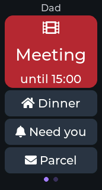
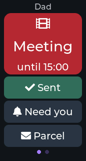

<!--
Copyright (c) 2026 limengdu

Licensed under the Apache License, Version 2.0 (the "License");
you may not use this file except in compliance with the License.
You may obtain a copy of the License at

    http://www.apache.org/licenses/LICENSE-2.0

Unless required by applicable law or agreed to in writing, software
distributed under the License is distributed on an "AS IS" BASIS,
WITHOUT WARRANTIES OR CONDITIONS OF ANY KIND, either express or implied.
See the License for the specific language governing permissions and
limitations under the License.
-->

# Door Sign

[简体中文](README.zh-CN.md) · [Muse skill](SKILL.md) · [Verification record](VALIDATION.md)

A study-door status sign for families working from home. Muse sets your availability
from your words or a calendar you have connected to Muse. People at the door can send
a short message with one tap, or hold **USR1** to leave a voice note. Both arrive in
your own Muse chat.




## What it does

- Red **Meeting**, amber **Focus**, green **Free**, blue **Away**, or a custom title and colour.
- The owner's name, a large state icon and a local end time. Narrow screens show this compact sign with reply buttons.
- Up to three 44 px reply buttons, pairing common messages with icons and short words. The tapped button shows **✓ Sent** for three seconds, with a shared ten-second tap cooldown.
- At the deadline, the sign becomes **Free** and sends an expiry notice to Muse.
- The sign, deadline and reply labels are saved in NVS, the board's persistent settings storage. `sign.clear` saves an inactive sign and restores the Muse face.
- Settings remain one swipe left. Holding USR1 records through the existing voice-note flow; the normal face and reply captions appear during the conversation. USR2 sleeps or wakes the display; waking returns to the sign.

## Hardware

Use the **Seeed XIAO ESP32-S3 1.47-inch Touch Display** and a USB power source.
It has a 172×320 JD9853A LCD, AXS5106L touch, a PDM microphone and two buttons.
Replies are text on screen. Hardware details and vendor references are in the
[board guide](../../esp32/devices/seeed-xiao-s3-147.md), based on
[Seeed's documentation](https://wiki.seeedstudio.com/getting_started_1.47_inch_touch_display_esp32s3/).
Mount it where the screen can be read and both buttons are reachable.

## Build, install and pair

Use **ESP-IDF v6.0.1**, activated in your shell. From the repository root:

```sh
cd esp32
tools/muse/board.sh build xiao147
idf.py -B build-muse-seeed-xiao-s3-147 menuconfig
tools/muse/board.sh build xiao147
```

In menuconfig, set **ESP32 Device SDK > Muse Gadgets SDK token** using your own
SDK token from **gadgets.muse.ai > Account > SDK tokens**. It is stored in the
ignored build directory's `sdkconfig`. Keep that value private. The XIAO overlay
enables `CONFIG_MUSE_DOOR_SIGN=y`; this selects device events and the shared clock.
Other boards keep their existing defaults. LVGL touch boards can opt in under **Muse > Door Sign with touch replies**.

Before the first installation, save the board's existing firmware, then flash
using its verified console port. From `esp32/`:

```sh
mkdir -p ../backups
python -m esptool -p PORT read-flash 0 ALL ../backups/door-sign-factory.bin
tools/muse/board.sh flash xiao147 PORT
```

1. In the Muse app, enable **Settings > Devices > Developer mode** and choose **Add Device**.
2. Select the `MuseGadget-XXXXXX` name shown on the screen, press **USR1** to confirm, and join 2.4 GHz Wi-Fi.
3. Copy [SKILL.md](SKILL.md) into your Muse chat and ask Muse to install it for this gadget.
4. Tell Muse whose door this is and your local time zone. Muse uses `clock.set` to set the current UTC epoch and local offset before applying a timed sign. Wi-Fi also starts network time synchronization.

See [foundation clock and events](../../esp32/docs/gadget-foundation.md) for clock
configuration, event queuing and `events.poll` recovery.

## Things to say to Muse

- “I'm in a meeting until 3. Put Dad on the door and let the family tell me dinner is ready.”
- “I'm focusing for an hour. Offer Need you and Parcel.”
- “I'm free now. Show Free.”
- “Show Recording with a purple background until 4.”
- “Set Focus every weekday from 9 to 11.”
- “Follow my work calendar during office hours, then clear the sign after work.”

Recurring schedules and calendar following run in Muse using its connected calendar
and routines. The device holds one current sign and one deadline.

## What people at home do

Read the colour, icon and status word. Tap one reply, then look for **✓ Sent**
inside the highlighted button for three seconds. This confirms the message entered the shared event queue;
Muse delivery follows the network connection. Repeated taps within ten seconds
are ignored. Hold **USR1** while speaking, then release to send the voice note.
Muse's answer appears as text. Press **USR2** to sleep or wake the screen.

## Commands

`sign.set` replaces the complete sign. Optional fields reset to the state's defaults.
It returns the saved sign after the background worker completes the storage write.
`sign.get` reads that state immediately; `sign.clear` saves `active: false`.
Both read and clear take an empty object or no parameters.

```json
{
  "state": "meeting",
  "owner": "Dad",
  "until": "15:00",
  "replies": ["Dinner", "Need you", "Parcel"]
}
```

| Field | Accepted values |
|---|---|
| `state` | Required: `meeting`, `focus`, `free`, `away`, `custom` |
| `title` | 1–40 UTF-8 bytes; use at most 10 characters, preferably one word, or omit for the state's on-screen word |
| `subtitle` | Optional, 0–80 UTF-8 bytes; default empty, not shown on narrow screens |
| `owner` | 1–24 UTF-8 bytes; default `Dad` |
| `until` | A future UTC epoch integer in 2024–2099, or exact local `HH:MM` for its next occurrence; requires a valid clock |
| `color` | `#RRGGBB`, for `custom` only; default purple |
| `replies` | 0–3 distinct, nonempty labels, each up to 28 UTF-8 bytes; use at most 12 characters each, such as `Dinner`, `Need you`, `Parcel`, `Call me`; `[]` hides all reply buttons |

Titles, owners and replies use printable text matching the board's Latin display
fonts. Status words use 28 px; a longer custom title uses 20 px over up to two
lines. Replies use 20 px, with 16 px available for wider words. Text is measured
before display, with an ellipsis for content exceeding the available two lines.
The owner uses 16 px and the end time 20 px. Existing voice reply captions retain
their normal language support. The accepted payload limits remain unchanged.

Common reply payloads such as `Dinner is ready` and `Parcel arrived` display as
home icon + **Dinner** and envelope icon + **Parcel**; **Need you** uses a bell.
`Call me` uses a phone, `OK` a checkmark, and other replies use text. Events and
`sign.get` retain the original message text. The stored default replies are:

| State | Default replies |
|---|---|
| `meeting` | Dinner is ready · Need you · Parcel arrived |
| `focus` / `custom` | Need you · Dinner is ready · Parcel arrived |
| `free` | Come here · Dinner is ready · Parcel arrived |
| `away` | Parcel arrived · Call me · I'm home |

## Events, limits and privacy

Taps arrive as `[door-sign event] Someone at Dad's door tapped "Dinner is ready" (18:32).`
Expiry arrives as `[door-sign event] Dad's door sign switched back to "Come in".`
JSON data distinguishes `kind: reply` and `kind: expired`. Voice notes use Muse's
existing voice channel; the skill identifies them as visitor messages while the sign is active.

The deadline is saved as an absolute epoch, including times crossing midnight.
After a reboot, time synchronization restores the local end time and expires overdue signs.
The clock uses a stored UTC offset; Muse updates it for travel or daylight saving time.
An unset clock permits an untimed sign and omits timestamps from taps.

Sign settings survive a reboot. Pending delivery, tap cooldown and confirmation
are kept in RAM; the foundation queues at most 16 pending events plus its current
turn, and retains 32 recent events for `events.poll` in that boot. Check the
foundation's dropped-event count when catching up after an outage. If a tap could
not enter the queue, its confirmation stays absent and a later tap can retry.

A door sign is visible to everyone nearby. Use general availability rather than
private meeting subjects. Visitor taps have no identity verification. Recording
starts while USR1 is held; voice notes are sent to the owner's Muse account.
Timing, microphone use, real chat delivery and reboot recovery still need the
[hardware checks](VALIDATION.md) on this implementation.
