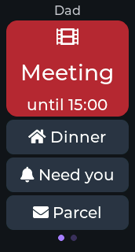
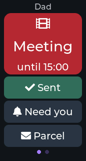

<!--
Copyright (c) 2026 limengdu

Licensed under the Apache License, Version 2.0 (the "License");
you may not use this file except in compliance with the License.
You may obtain a copy of the License at

    http://www.apache.org/licenses/LICENSE-2.0

Unless required by applicable law or agreed to in writing, software
distributed under the License is distributed on an "AS IS" BASIS,
WITHOUT WARRANTIES OR CONDITIONS OF ANY KIND, either express or implied.
See the License for the specific language governing permissions and
limitations under the License.
-->

# Door Sign 家庭门牌

[English](README.md) · [Muse 技能](SKILL.md) · [验证记录](VALIDATION.md)

在家办公时，把自己的状态挂在书房门口。你可以让 Muse 根据一句话或已连接的日历设置门牌；家人在门口点一下就能告诉你“饭好了”“找你有事”“快递到了”，也可以按住 **USR1** 留语音。两种消息都会进入你自己的 Muse 对话。




## 能做什么

- 显示红色 **Meeting**、琥珀色 **Focus**、绿色 **Free**、蓝色 **Away**，也能自定义标题和颜色。
- 显示主人名字、大状态图标和本地截止时间；窄屏门牌由这些内容和回复按钮组成。
- 提供最多三个 44 px 高的按钮，常见消息显示为图标和短词；成功入队后，被点按钮内显示三秒 **✓ Sent**，所有按钮共用十秒的重复点击间隔。
- 截止后自动改成绿色 **Free**，并通知 Muse。
- 门牌、截止时间和回复选项保存在设备存储中，重启后恢复；`sign.clear` 保存关闭状态，恢复 Muse 表情。
- 向左滑仍可进入设置。按住 USR1 继续使用原来的语音留言流程，录音和查看回复时显示原来的界面；USR2 休眠或唤醒屏幕，唤醒后回到门牌。

## 硬件

使用 **Seeed XIAO ESP32-S3 1.47 英寸触摸显示屏**和 USB 电源。它带有 172×320 JD9853A 屏幕、AXS5106L 触摸、PDM 麦克风和两个按键；Muse 回复显示为文字。硬件和厂商来源见[板卡指南](../../esp32/devices/seeed-xiao-s3-147.zh-CN.md)，来源包括 [Seeed 官方说明](https://wiki.seeedstudio.com/getting_started_1.47_inch_touch_display_esp32s3/)。固定在看得清屏幕、摸得到两个按键的位置。

## 编译、安装与配对

在终端启用 **ESP-IDF v6.0.1**，从仓库根目录执行：

```sh
cd esp32
tools/muse/board.sh build xiao147
idf.py -B build-muse-seeed-xiao-s3-147 menuconfig
tools/muse/board.sh build xiao147
```

在 menuconfig 的 **ESP32 Device SDK > Muse Gadgets SDK token** 中填写自己的 SDK token，获取位置是 **gadgets.muse.ai > Account > SDK tokens**。它保存在已被 Git 忽略的构建目录 `sdkconfig` 中，请妥善保管。XIAO 配置已启用 `CONFIG_MUSE_DOOR_SIGN=y`，同时启用共享的设备事件和时钟；其他板卡保留现有默认设置。其他 LVGL 触摸板可在 **Muse > Door Sign with touch replies** 中自行启用。

首次安装前，确认串口属于这块板，先备份原固件，再烧录。从 `esp32/` 执行：

```sh
mkdir -p ../backups
python -m esptool -p PORT read-flash 0 ALL ../backups/door-sign-factory.bin
tools/muse/board.sh flash xiao147 PORT
```

1. 在 Muse 应用打开 **Settings > Devices > Developer mode**，选择 **Add Device**。
2. 选择屏幕显示的 `MuseGadget-XXXXXX`，按 **USR1** 确认，再连接 2.4 GHz Wi-Fi。
3. 把 [SKILL.md](SKILL.md) 内容复制到 Muse 对话，让 Muse 为这块设备安装技能。
4. 告诉 Muse 这是谁的门、你所在的时区。设置有截止时间的门牌前，Muse 用 `clock.set` 设置当前 UTC 时间和本地时差；Wi-Fi 连接后也会启动网络校时。

时钟、事件队列和通过 `events.poll` 找回近期消息的说明见[共享基础模块](../../esp32/docs/gadget-foundation.md)。

## 可以对 Muse 说什么

- “我开会到下午三点，门牌写 Dad，让家人能告诉我饭好了。”
- “我要专注一小时，提供找我有事和快递到了两个选项。”
- “我现在有空，显示 Free。”
- “显示 Recording，背景紫色，持续到四点。”
- “工作日每天九点到十一点显示专注。”
- “上班时间跟随工作日历，下班后清掉门牌。”

周期安排和跟随日历由 Muse 已连接的日历与定时功能执行；设备保存当前一块门牌和一个截止时间。

## 门口的家人怎么用

先看颜色、图标和状态短词，需要联系时点一个回复按钮。被点按钮高亮，内部显示三秒 **✓ Sent**，表示消息已加入共享发送队列；网络连接后继续送到 Muse。十秒内重复点击会被忽略。也可以按住 **USR1** 讲话，松开后发送语音，Muse 的回复显示在屏幕上。按 **USR2** 让屏幕休眠或唤醒。

## 命令

`sign.set` 每次完整替换门牌，省略的字段恢复该状态的默认值；后台保存完成后返回结果。`sign.get` 立即读取已保存状态；`sign.clear` 保存 `active: false`。读取和清除接受空对象或不传参数。

```json
{
  "state": "meeting",
  "owner": "Dad",
  "until": "15:00",
  "replies": ["Dinner", "Need you", "Parcel"]
}
```

| 字段 | 可填写的内容 |
|---|---|
| `state` | 必填：`meeting`、`focus`、`free`、`away`、`custom` |
| `title` | 1–40 个 UTF-8 字节；建议不超过 10 个字符，优先一个单词，省略时显示状态短词 |
| `subtitle` | 可选，0–80 个 UTF-8 字节，默认空白，窄屏不显示 |
| `owner` | 1–24 个 UTF-8 字节，默认 `Dad` |
| `until` | 2024–2099 年范围内的未来 UTC 整数秒，或严格的本地 `HH:MM`，表示下一次到达该时刻；需要有效时钟 |
| `color` | 仅 `custom` 可填写 `#RRGGBB`，默认紫色 |
| `replies` | 0–3 条不同的非空文字，每条最多 28 个 UTF-8 字节；建议每条不超过 12 个字符，例如 `Dinner`、`Need you`、`Parcel`、`Call me`；传 `[]` 隐藏回复按钮 |

标题、姓名和回复使用可打印文字，建议用简短英文匹配门牌的拉丁字形字体。状态短词使用 28 px，较长的自定义标题使用 20 px、最多两行；回复优先 20 px，较宽的单词可降为 16 px。显示前先测量文字，两行仍放不下时才用省略号。主人名字使用 16 px，截止时间使用 20 px。原有命令接受的长度范围保持不变，语音回复字幕保留原来的语言支持。

常见回复 `Dinner is ready` 显示为房屋图标和 **Dinner**，`Parcel arrived` 显示为信封图标和 **Parcel**，**Need you** 配铃铛，`Call me` 配电话，`OK` 配对勾，其他回复直接显示文字。点击事件和 `sign.get` 保留原始文字。设备保存的默认回复如下：

| 状态 | 默认回复 |
|---|---|
| `meeting` | Dinner is ready · Need you · Parcel arrived |
| `focus` / `custom` | Need you · Dinner is ready · Parcel arrived |
| `free` | Come here · Dinner is ready · Parcel arrived |
| `away` | Parcel arrived · Call me · I'm home |

## 消息、限制与隐私

点击消息的格式是 `[door-sign event] Someone at Dad's door tapped "Dinner is ready" (18:32).`；到期消息是 `[door-sign event] Dad's door sign switched back to "Come in".`。附带的 JSON 用 `kind: reply` 和 `kind: expired` 区分两种消息。语音仍通过 Muse 原来的语音通道发送，技能会在门牌开启时将其理解为门口访客的留言。

截止时间保存为绝对时间，跨午夜也能继续计算；重启后等待校时，再恢复本地截止时间或处理已经到期的门牌。时钟保存固定 UTC 时差，旅行或夏令时切换时由 Muse 更新。时钟还没准备好时可以设置不限时门牌，点击消息暂不带时间。

门牌设置会保留到下次启动；待发送消息、点击间隔和屏幕确认保存在内存。共享基础模块最多保存 16 条待发送事件和一条正在处理的消息，本次启动还保留最近 32 条事件供 `events.poll` 查询。断网后补查时同时查看丢失计数。点击未能入队时，屏幕不会显示成功提示，可以稍后重试。

门口的人都能看到门牌，建议使用一般状态，会议主题等私人信息留在自己的 Muse 对话中。点击按钮无法识别访客身份；按住 USR1 才开始录音，语音发送到门牌主人的 Muse 账号。本次实现的时间、麦克风、真实消息送达和断电恢复仍需按照[验证记录](VALIDATION.md)进行实机检查。
